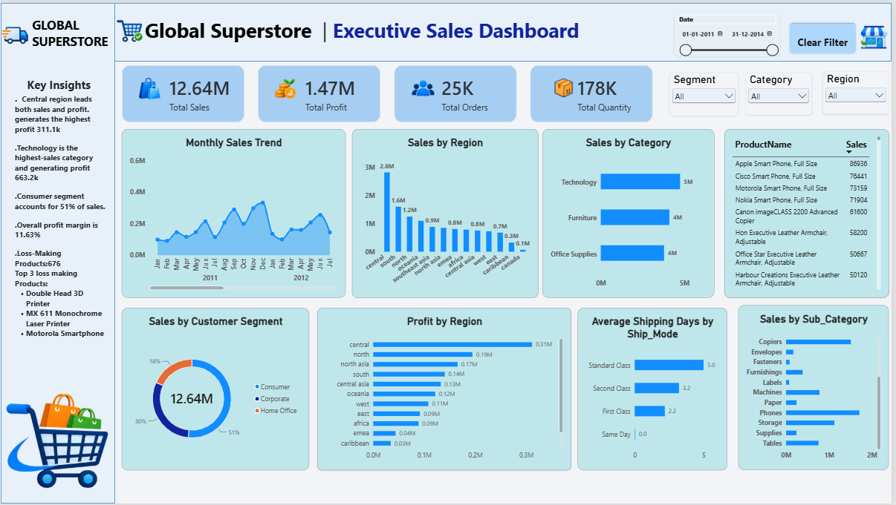

# Global Superstore_Executive_Sales_Dashboard
# 📊 Global Superstore Data Analysis – SQL & Power BI

## 📌 Project Overview

This project focuses on analyzing Global Superstore sales data using **Microsoft Excel, SQL Server, and Power BI** to generate meaningful business insights into sales performance, profitability, customer segments, regional performance, product sales, shipping methods, and business trends.

The project follows an end-to-end data analytics workflow, starting with data cleaning and preparation in Excel, followed by business analysis using SQL Server and interactive dashboard development using Power BI.

The dashboard helps monitor business performance, identify profitable and loss-making products, understand customer purchasing patterns, analyze regional contributions, and support data-driven business decisions.

## 🎯 Objectives

- Analyze overall sales, profit, quantity, and order performance.
- Identify regions contributing the highest sales and profit.
- Compare sales and profitability across product categories.
- Analyze sub-category performance and product profitability.
- Identify top-performing and loss-making products.
- Understand customer segment contributions to total sales.
- Analyze monthly and yearly sales performance.
- Evaluate shipping methods and average delivery duration.
- Calculate average discounts and understand their impact on profitability.
- Identify business opportunities through data-driven insights.
- Validate SQL analysis results against Power BI visualizations.

---

## 🏗️ Data Source & Data Processing

This project follows an end-to-end data analytics workflow using Microsoft Excel, SQL Server, and Power BI.

### ⭐ Data Preparation – Microsoft Excel

- Imported the original Global Superstore dataset.
- Examined the dataset for missing and duplicate values.
- Identified inconsistent text values and formatting issues.
- Standardized inconsistent values.
- Checked date formats and data types.
- Prepared the cleaned dataset for SQL analysis and Power BI.

### 📚 Dataset Details

The project includes the following data:

- **Raw_dirty Dataset** – Original Global Superstore data before cleaning.
- **Cleaned Dataset** – Prepared data using Microsoft Excel for SQL analysis and Power BI visualization.

### 🔄 Data Analysis – SQL Server

- Imported the cleaned dataset into SQL Server.
- Performed 20 business analysis questions.
- Used aggregate functions to calculate sales, profit, quantity, and orders.
- Applied GROUP BY and HAVING for grouped analysis.
- Used CASE statements and date functions.
- Applied subqueries, CTEs, and window functions where required.
- Analyzed regional, category, customer, product, and shipping performance.

### 📊 Data Visualization – Power BI

- Imported the cleaned dataset into Power BI.
- Created a DateTable for time-based analysis.
- Established relationships between relevant tables.
- Created DAX measures for KPI calculations.
- Developed interactive charts and KPI cards.
- Added slicers and Clear Filters functionality.
- Built an executive sales dashboard.
- Compared SQL query results with Power BI visualizations to validate consistency.

---

## 🗄️ SQL Analysis – 20 Business Questions

The project includes 20 SQL business analysis questions covering:

1. Calculate total sales.
2. Calculate total profit.
3. Calculate total quantity sold.
4. Find the total number of unique orders.
5. Find the total number of unique customers.
6. Analyze sales by category.
7. Analyze sales by customer segment.
8. Analyze profit by category.
9. Identify the most and least profitable sub-categories.
10. Analyze sales by region.
11. Identify the top 10 countries by sales.
12. Analyze profit by market.
13. Analyze orders by shipping mode.
14. Analyze monthly sales trends.
15. Evaluate yearly sales and profit performance.
16. Analyze orders by priority.
17. Calculate average discount.
18. Identify the top 10 products by sales.
19. Identify the bottom 10 products by profit.
20. Identify the top 10 customers by profit.

**SQL Concepts Used:**

- SELECT, DISTINCT, WHERE, ORDER BY
- GROUP BY and HAVING
- Aggregate Functions
- CASE Statements
- Date Functions
- Subqueries
- Common Table Expressions (CTEs)
- Window Functions
- Ranking Functions

---

## 📈 Dashboard Features

### ⭐ KPI Cards

- Total Sales
- Total Profit
- Total Orders
- Total Quantity

### 📊 Data Visualizations

- Monthly Sales Trend
- Sales by Region
- Sales by Category
- Sales by Customer Segment
- Profit by Region
- Average Shipping Days by Shipping Mode
- Sales by Sub-Category
- Product Sales Analysis

### 🎛️ Interactive Features

- Date Period Slicer
- Customer Segment Slicer
- Category Slicer
- Region Slicer
- Clear Filters Button
- Interactive Dashboard Filtering

---

## 🛠️ Tools & Technologies

- **Microsoft Excel** – Data cleaning and preparation
- **SQL Server (SSMS)** – Data analysis and business queries
- **Microsoft Power BI** – Dashboard development
- **Power Query** – Data preparation and transformation
- **DAX** – KPI calculations and analytical measures
- **Data Modeling** – Date table and table relationships
- **Data Visualization** – Interactive business reporting
- **GitHub** – Project documentation and portfolio hosting

---

## 📸 Dashboard Preview

### Global Superstore – Executive Sales Dashboard

---

## 🔍 Key Business Insights

The analysis identified the following business findings:

- **Overall Sales:** The company generated approximately $12.64M in total sales.
- **Overall Profit:** Total profit reached approximately $1.47M.
- **Profit Margin:** The overall profit margin is approximately 11.63%.
- **Total Orders:** The business processed approximately 25K unique orders.
- **Total Quantity:** Approximately 178K units were sold.
- **Regional Performance:** Central region leads regional sales with approximately $2.8M and profit with approximately $0.31M.
- **Category Performance:** Technology is the leading sales category, generating approximately $5M.
- **Customer Segment:** Consumer customers contribute approximately 51% of total sales.
- **Shipping Performance:** Same Day shipping has the shortest average shipping duration, while Standard Class takes approximately 5 days.
- **Loss-Making Products:** 676 products were identified as loss-making.
- **Highlighted Loss-Making Products:** CubicX 3D Printer, MX 611 Monochrome Laser Printer, and Motorola Smartphone.

---

## 💡 Business Recommendations

- Review pricing and discount strategies for loss-making Electronics products.
- Investigate the reasons behind negative product profitability.
- Maintain strong sales and profitability in the Central region.
- Continue focusing on the high-performing Technology category.
- Develop strategies to improve performance in weaker-performing regions.
- Monitor shipping costs and delivery performance.
- Use customer segment analysis to improve sales strategies.
- Regularly monitor sales and profit trends to support business decisions.

---

## 🚀 Conclusion

This project demonstrates how **Microsoft Excel, SQL Server, and Power BI** can be used to transform raw sales data into meaningful business insights.

By cleaning and preparing the dataset, performing 20-25 SQL business analysis questions, and developing an interactive Power BI dashboard, the project provides a structured approach to analyzing sales performance, profitability, customer behavior, regional contributions, and product performance.

The SQL analysis results were compared with Power BI visualizations to verify consistency and accuracy.

The project demonstrates practical data analytics skills, including data cleaning, SQL querying, data modeling, DAX calculations, dashboard development, and business insight generation.

